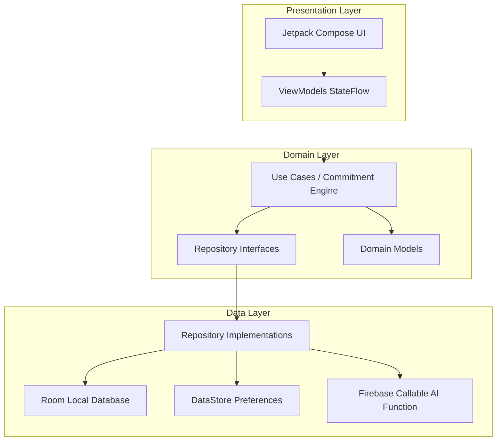

# FocusFlow — AI-Powered Productivity & Study Assistant

[](https://developer.android.com)
[](https://kotlinlang.org)
[](https://developer.android.com/jetpack/compose)
[](https://developer.android.com/topic/architecture)
[](LICENSE)

**FocusFlow** is an Android application in active development for students and professionals. It combines smart goal breakdown, AI-assisted study planning, deep Pomodoro focus sessions, habit streak tracking, real-time analytics, an interactive **AI Study Assistant**, and a unique **Commitment Lock** accountability engine.

### Interface
- **Floating navigation**: A true overlay with no full-width backing strip. The dock contracts from 288 x 60 dp to 216 x 52 dp after scrolling down and expands when scrolling up or switching tabs.
- **Keyboard behavior**: Navigation hides while the keyboard is open, keeping chat and form inputs accessible.
- **Compact dashboard**: Focus time, task progress, quick actions, and today's plan use real app state with a consistent spacing scale.
- **Themes**: Neutral Material 3 surface roles keep the light and dark palettes consistent without default cream-colored containers.
- **Accessibility**: Navigation keeps 48 dp touch targets and selected-tab semantics in both sizes.

---

## 🌟 Key Features

### 🔐 Commitment Lock & Focus Contract
- **Voluntary Accountability**: Attach a commitment to critical tasks with a strict deadline and user-selected consequences (such as policy-compliant app restriction reminders).
- **Commitment States**: Active commitments warn before the deadline and become completed or missed. Missed commitments retain restrictions until task completion or cancellation.
- **Emergency Cancellation**: Transparent, non-punitive options with score impact warning.
- **Recovery UI (in progress)**: Recovery screens are scaffolding; generated recovery plans are not implemented.
- **Unlocking**: Complete the linked task or cancel the commitment to remove its restrictions. Timed earn-back is not implemented.
- **Commitment Score**: Transparent accountability metric based on completion, recovery, and consistency trends.

### 🤖 AI-Powered Productivity
- **AI Task Breakdown**: Converts high-level goals into structured, prioritized subtasks with time estimates.
- **AI Study/Productivity Planner**: Generates daily study plans customized by skill level, available hours, and preferred study times.
- **AI Insights & Recommendations**: Identifies peak productivity hours and recommends optimal scheduling.
- **Secure Architecture**: AI operations route through a backend proxy model—zero hardcoded API keys in the client APK.

### ⏱️ Deep Focus & Pomodoro
- **Timer Presets**: 25/5 Pomodoro, 50/10 Deep Focus, and fully customizable durations.
- **Interactive Timer UI**: Animated Compose circular progress indicator with work/break state management.
- **Session History**: Detailed logs linking focus sessions to specific tasks and commitments.

### 📋 Task & Goal Management
- **Full Task Lifecycle**: Priority flags (Urgent, High, Medium, Low), due dates, estimated durations, categories, reminders, and nested subtasks.
- **Filter & Search**: Instant filtering by Today, Upcoming, Completed, High Priority, or search query.
- **Goals Alignment**: Link tasks to overarching long-term goals and visualize progress rings.

### 🔄 Habits & Streaks
- **Habit Tracking**: Daily, weekly, or custom-day frequency schedules.
- **Streak Engine**: Tracks current streak, longest streak, and completion rate.

### 📊 Analytics & Insights
- **Real-Data Charts**: Visualizes focus minutes, task completion rates, habit consistency, and commitment scores over Week, Month, or Year.
- **Offline-First Storage**: Local database acts as single source of truth—no empty states or fake statistics once data exists.

### 🌐 Offline Capability
- **Offline-First Architecture**: Powered by Room DB and DataStore for full offline access.
- **Firestore Rules**: Owner-scoped rules are included for a future cloud-sync implementation. Cloud sync is not currently implemented in the Android repositories.

---

## 🏗️ Architecture & Tech Stack

FocusFlow strictly follows **Clean Architecture** and **MVVM** design principles:



### Technology Stack
- **Language**: Kotlin 2.4.21 (Coroutines & Flow)
- **UI Framework**: Jetpack Compose, Material 3, Navigation Compose
- **Dependency Injection**: Dagger Hilt
- **Local Persistence**: Room Database (Offline-First), Preferences DataStore
- **Remote Services**: Firebase Authentication, Firebase Callable Functions, Firebase Cloud Messaging
- **Background Processing**: WorkManager
- **Networking**: Firebase callable functions, Kotlinx Serialization
- **Testing**: JUnit 4, Mockk, Google Truth, Turbine

---

## 📂 Project Structure

```
com.focusflow.app/
├── data/
│   ├── local/              # Room entities, DAOs, Converters, DataStore
│   ├── remote/             # Network API clients, DTOs
│   └── repository/         # Repository implementations
├── domain/
│   ├── model/              # Domain models (Task, Goal, Habit, Commitment...)
│   ├── repository/         # Clean domain repository interfaces
│   └── usecase/            # Business logic & Commitment Engine use cases
├── presentation/
│   ├── auth/               # Login, Register, Forgot Password
│   ├── onboarding/         # Onboarding pager & preferences
│   ├── home/               # Dashboard, Progress rings, Active Commitment card
│   ├── tasks/              # Task CRUD, filters, details
│   ├── commitment/         # Commitment Lock flow, app selection, review, missed, recovery
│   ├── focus/              # Pomodoro timer, active session, completion
│   ├── habits/             # Habit tracking, creation, streaks
│   ├── planner/            # AI study planner & goal breakdown
│   ├── analytics/          # Productivity charts & Commitment Score
│   ├── settings/           # Appearance, notifications, account, privacy
│   ├── theme/              # Color, Type, Shape, Theme tokens
│   └── components/         # Reusable design system components
├── navigation/             # Screen routes & Animated NavHost
├── service/                # AppRestrictionManager, WorkManager workers, NotificationHelper
└── di/                     # Hilt DI Modules
```

---

## 🚀 Building & Setup

### Prerequisites
- JDK 21 (Android Studio bundled JBR is suitable)
- Android SDK (API 37, Min SDK 26)
- Android Studio Ladybug / Koala or CLI

### Step 1: Clone Repository
```bash
git clone https://github.com/MohammadMohid03/focusflow.git
cd focusflow
```

### Step 2: Environment Configuration
Create `local.properties` in the root directory:
```properties
sdk.dir=C:/Users/moham/AppData/Local/Android/Sdk
```

### Step 3: Firebase Configuration
Place your `google-services.json` inside `app/`, then select the Firebase project for the CLI:
```bash
firebase use --add
```

### Step 4: Configure and deploy the AI proxy
The Android client calls the authenticated `generateAi` Firebase callable function. Store the Groq key in Firebase Secret Manager; do not add it to `local.properties`, Gradle, or the Android app:
```bash
npm --prefix backend install
firebase functions:secrets:set GROQ_API_KEY
firebase deploy --only functions,firestore:rules
```
The function requires a signed-in Firebase user and enforces per-user request limits. Deploying it also requires a Firebase project with Cloud Functions enabled.

### Step 5: Build Debug APK
```bash
./gradlew assembleDebug
```

### Step 6: Run checks
On Windows:
```powershell
.\gradlew.bat testDebugUnitTest assembleDebug lintDebug compileDebugAndroidTestKotlin
npm --prefix backend test
```
Room migration, owner isolation, export, and deletion instrumentation tests require an Android device or emulator:
```powershell
.\gradlew.bat connectedDebugAndroidTest
```


### Step 7: Generate Production Release Bundle (AAB)
```bash
./gradlew bundleRelease
```

---

## 🔒 Security & Privacy

- **No Client Provider Key**: AI requests go through an authenticated Firebase callable function; the Groq key is stored as a server-side secret.
- **Account Deletion**: Deletes the signed-in Firebase Authentication account and that account's local records. Firebase may require a fresh sign-in before deletion. Guest deletion clears only guest records.
- **Export**: Saves an owner-scoped JSON export through Android's file picker.
- **Settings**: Notification switches and default focus/break durations persist locally. Cloud sync is unavailable and is labeled accordingly.
- **Database Upgrades**: The v1-to-v2 migration preserves data; missing future migrations fail instead of deleting records.
- **Data Minimization**: App restriction preferences remain local to the device and are never uploaded to analytics or AI backends.
- **Firestore Isolation**: Security rules restrict all reads/writes strictly to authenticated owner user IDs.

---

## 📄 License

FocusFlow is released under the [MIT License](LICENSE).

## Build and validation

Use JDK 21 (for example Android Studio's bundled JBR), Android SDK Platform 37,
and SDK Build Tools 36.0.0 or newer. The Gradle wrapper supplies Gradle 9.8.2.
Configure `JAVA_HOME` for your local JDK and `sdk.dir` in the ignored
`local.properties`; no machine-specific JDK path is committed.

```shell
./gradlew assembleDebug testDebugUnitTest lintDebug
./gradlew connectedDebugAndroidTest
```

Lint warnings fail the build. Keep the resource set and dependency catalog clean;
do not add a lint baseline or disable checks to make validation pass.

The launcher logo source and generation prompt are in [branding/LOGO.md](branding/LOGO.md).
The splash screen retains the original rotating emblem, loading arc, and text animation.
